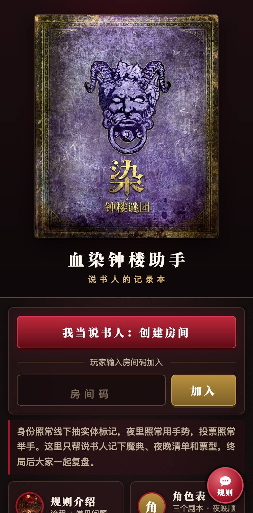
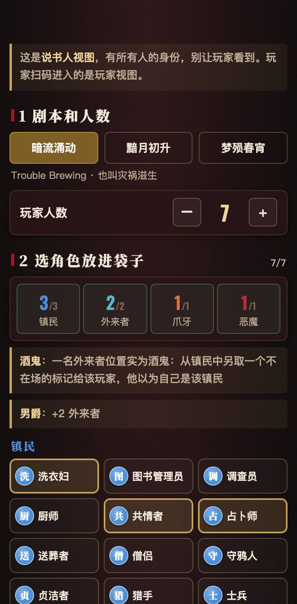
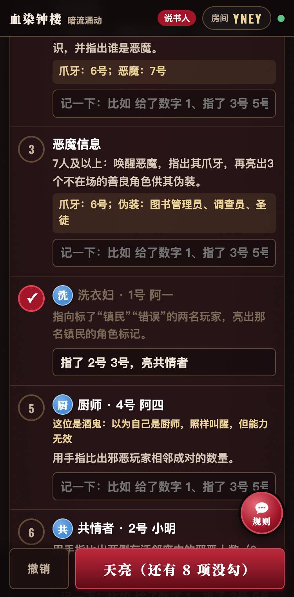
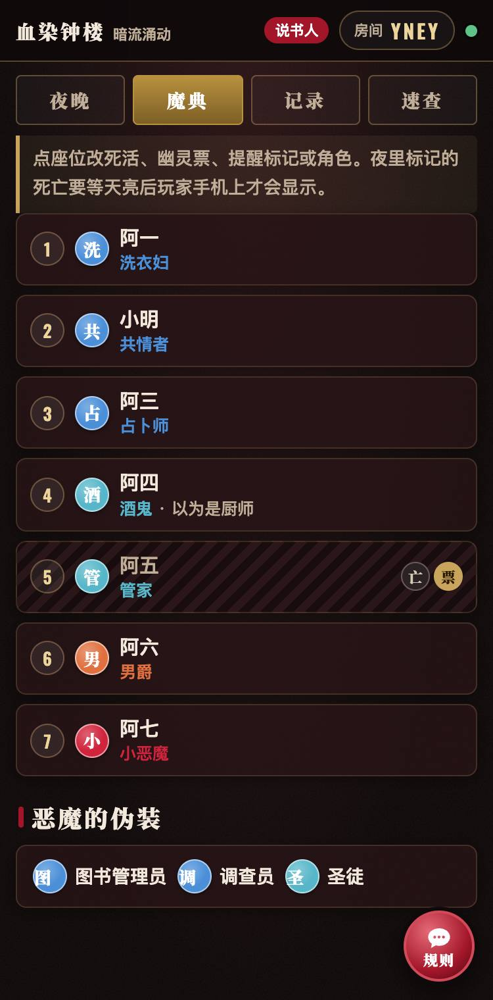
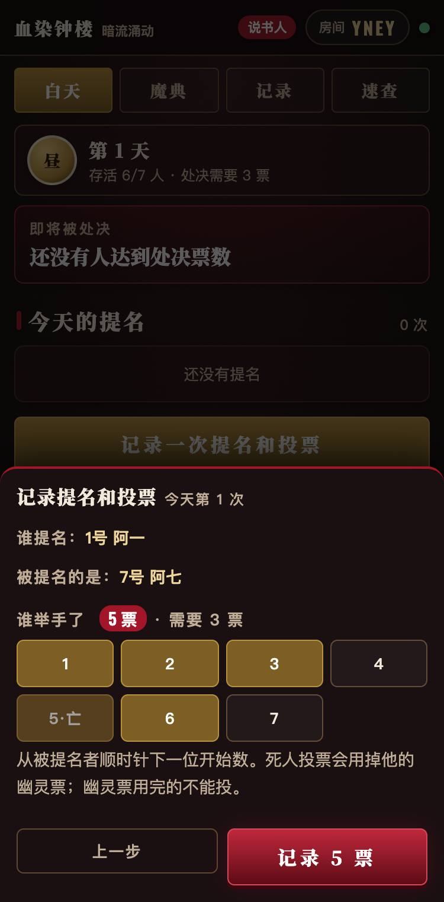
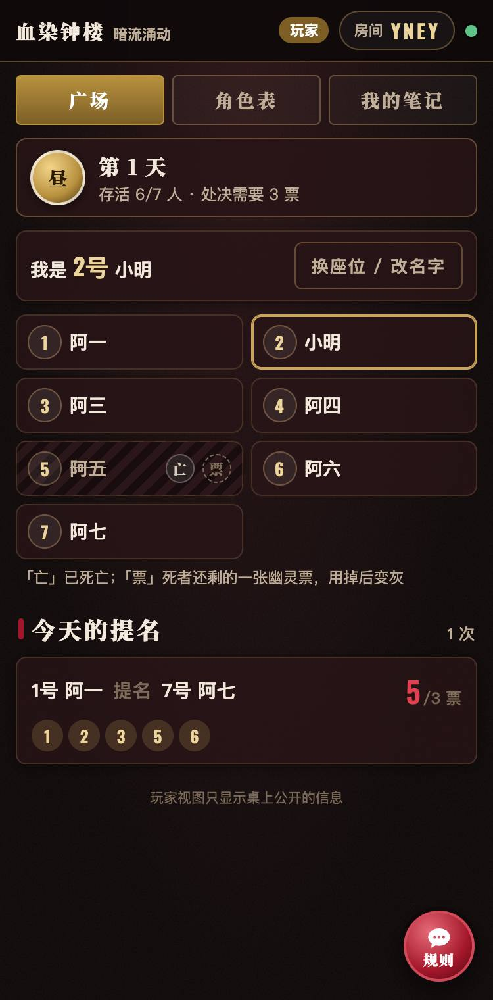
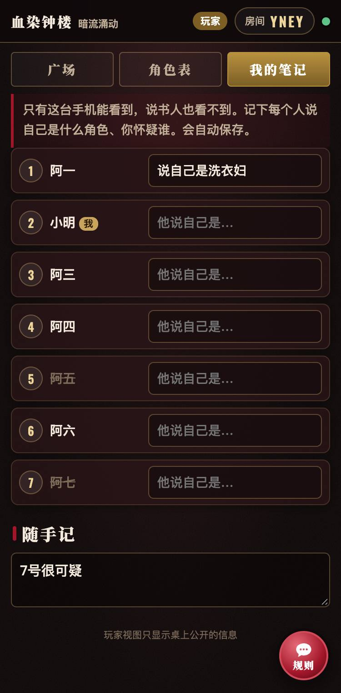
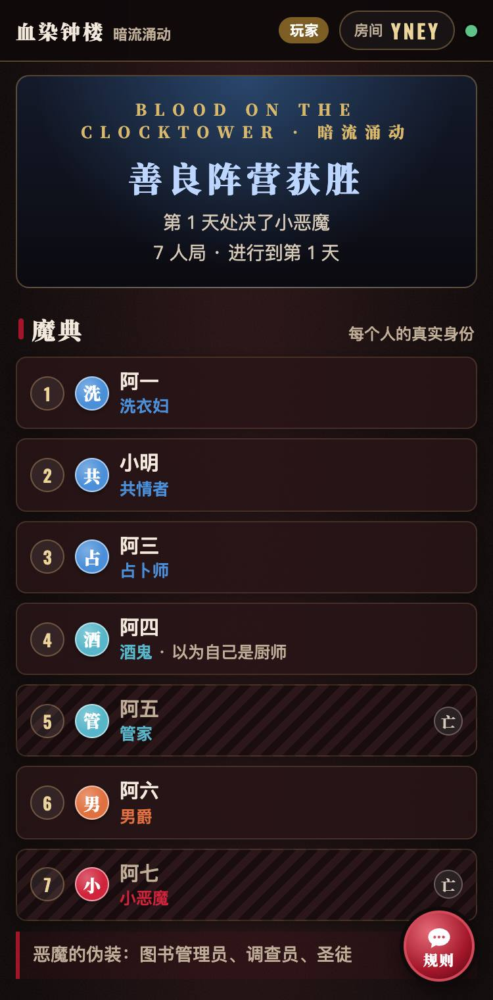

<div align="center">

# 血染钟楼助手

**说书人的记录本**

《血染钟楼》（Blood on the Clocktower，中文版《染·钟楼谜团》）线下面杀的辅助工具：说书人记魔典、夜晚清单、夜间日志和提名票型；玩家扫码看公开信息、角色表，记自己的笔记；终局后所有人一起复盘。

身份照常线下抽实体标记，夜里照常用手势，投票照常举手。网站不发身份、不替说书人裁定，只记下容易记错、记漏的东西。

「桌游小助手」系列（[boardgame.leisurecat.cloud](https://boardgame.leisurecat.cloud)）的姊妹站。



</div>

---

## 为什么做这些、不做那些

开发前调研了 BGG（970 个主题）、Reddit、B 站、小红书、贴吧，以及已有工具（官方 App、clocktower.online、Pocket Grimoire、集石官方魔典等）。清单见 [docs/调研清单.md](docs/调研清单.md)。

- **做**：中英文社区最集中的痛点是说书人记不住、记串信息，其次是夜里漏叫人、白天算票，以及终局复盘。
- **不做**：手机发身份、手机投票、夜里往玩家手机推信息、自动裁定、计时器、私聊组织、自定义剧本。理由是社区明确更喜欢实体抽牌和举手投票，夜里手机亮屏还会暴露谁醒了。

## 功能一览

### 开局：剧本、人数、袋子、谁抽到了什么



- 选剧本：暗流涌动、黯月初升、梦殒春宵，附常见别名。
- 选人数（5–15 人）后，自动显示镇民、外来者、爪牙、恶魔各几个。
- 选角色放进袋子，每类数量实时对照。男爵、教父、方古、亡骨魔会改外来者数量，所有可能的组合都算进去。
- 玩家抽完实体标记后，说书人按座位点选。酒鬼、疯子、提线木偶另选"他以为自己是谁"。
- 选恶魔的 3 个伪装。玩家也可以扫码自己选座位、填名字。

### 夜晚：只列本夜该醒的角色



- 按官方夜晚顺序，只列本局在场、本夜要醒的角色。
- 首夜 7 人及以上，包含爪牙信息和恶魔信息，旁边直接写出爪牙、恶魔是几号，以及伪装是什么。
- 酒鬼按他以为的角色出现，并标出"能力无效"。
- 死人留在清单里但变灰，因为有的能力在死亡当晚生效。
- 每项可以打勾，也可以记一句给了谁什么信息。
- 天亮时如果还有没勾的项会提醒，防止漏叫人。

### 帮说书人算信息

夜晚清单里，下面这些角色会直接显示"真实信息"，可以一键写进这一步的记录：

- **自动算**：厨师、共情者、钟表匠、神谕者、卖花女孩、城镇公告员、送葬者。洗衣妇、图书管理员、调查员、教父会列出在场的对应角色。
- **说书人点选目标后算**：占卜师（含干扰项）、守鸦人、女裁缝、侍女（按已打勾的步骤）、杂耍艺人（逐个选猜的角色）。
- **数学家**：照官方做法，说书人给能力异常的玩家放「未正常生效」标记，数学家醒来时自动数，给完信息一键清掉。
- **常驻效果**：夜晚清单顶部会显示茶艺师保护了谁、诺-达鲺毒了哪两名镇民（官方说明：不论死活，跳过非镇民）、涡流是否在场。

算出来的只是参考。持有者醉酒、中毒（含诺-达鲺的邻座）、是酒鬼，或者涡流在场时会标红提醒，给不给错误信息由说书人决定。陌客、间谍可能被当作另一阵营或别的角色时，显示可能的取值范围，不替说书人选。规则依据各角色官方 Wiki 的 Summary 和 How to Run。

### 魔典



- 座位围成一圈，和桌上一样（1 号在正上方，顺时针），方便看相邻关系。点座位记死活、幽灵票，以及每个在场角色的提醒标记。玩家手机上的广场也是同样的圆圈，只显示名字和死活。
- 可以改角色，比如恶魔传位、被换了角色。
- 所有操作都能撤销，最多 30 步。

### 白天：提名和票型



- 依次选谁提名、提名谁、谁举了手，自动算票数和门槛（存活人数的一半，向上取整），以及当前谁将被处决（平票则无人）。
- 自动执行这些限制：死人不能提名；每人每天只能提名一次、被提名一次；死人投票会用掉幽灵票，用完就不能再投。
- 最后记处决结果，或者"被处决但没死"。

### 玩家手机

 

- **广场**：谁死了、谁的幽灵票用了、今天的提名和票型、处决记录。
- **角色表**：本剧本角色的简述，以及首夜、其他夜晚的顺序。
- **我的笔记**：按座位记"他说自己是什么"，外加随手记。只存在这台手机的随机令牌下，说书人也看不到；刷新、换网后还在。

### 终局复盘



- 说书人宣布胜负后，所有人都能看到完整魔典：真实身份、"以为自己是谁"、提醒标记、恶魔伪装，以及每晚的日志和每天的票型。
- 可以一键存长图。
- 每局自动存档，首页「往期对局」能查到。
- 页面上有评价卡，可以给这款游戏打分。

### 规则介绍、角色表、规则助手

- **规则介绍**：16 节规则讲解和 40 条常见问题，每条标了出处（集石钟楼百科或官方 Wiki）。
- **角色表**：三个剧本共 72 个角色，附本站自写的简述和夜晚顺序。
- **规则助手**：每页右下角的悬浮窗，做法和匹兹堡助手相同。
  - 模型顺序：DeepSeek V4.1 Flash（`deepseek-flash`）→ Workers AI 的 Qwen3.8 27B（`@cf/qwen/qwen3.8-27b`）→ DeepSeek V4 Pro（`deepseek-v4-pro`）。
  - 每个模型 9 秒内须开始回答，中途停顿超过 8 秒就换下一个。
  - 每小时用 cron 检查 DeepSeek，不通时下一小时先用 Qwen。
  - 回答下方不显示是哪个模型。
  - **只讲规则**：请求里只有对话内容，服务端也不会往提示词里放任何房间数据，所以它不可能知道本局的身份。被问"谁是恶魔"会直接拒绝。角色之间有歧义的互动不下定论，交给说书人裁定。

### 给这款游戏打分

结算页有评价卡：说书人显示为"说书人"，玩家默认用座位上的名字，也可以改。提交到总入口的统一评价接口 `POST https://boardgame.leisurecat.cloud/api/reviews`，game key 是 `botc`。请求里只有星数、名字、评论和房间码。

## 隐藏信息怎么防

- 建房间时，服务端生成房间码和 128 位随机密钥，密钥只存在说书人手机里。
- 每个 WebSocket 连接都先当作玩家，只收到 `publicView()` 的结果。发来正确密钥的连接才变成说书人，收到完整状态。
- 玩家能做的唯一操作是改自己座位的名字。
- `publicView()`（`public/logic.js`）按白名单逐个字段生成。终局前只有：剧本、人数、阶段、座位名字、死活、幽灵票、提名票型、处决记录。没有角色、"以为自己是谁"、提醒标记、伪装、袋子、夜晚清单和日志。
- **夜里的死亡等天亮才显示**：公开视图里的死活和幽灵票，夜间停留在黄昏时的样子。
- **夜里不推送**：公开视图没变就不给玩家发消息，玩家手机不会因为收到消息的多少，推测出说书人夜里忙不忙。
- **玩家笔记**按随机令牌存在服务端，只发给持有同一令牌的连接。说书人和其他玩家都拿不到。
- 往期对局读取时要密钥。
- 在另一台设备继续当说书人：分享面板里的「复制说书人链接」把密钥放在 `#` 后面（不会发到服务器）。
- `tests/test_leak.mjs` 每个剧本跑 3 局随机对局，逐帧检查两个玩家和一个旁观者收到的所有消息。

## 资料来源与核对

| 内容 | 依据 |
|---|---|
| 规则讲解、常见问题 | [集石钟楼百科](https://clocktower-wiki.gstonegames.com/)（"规则概要"即中文规则书正文，另有规则解释、重要细节、术语汇总、给说书人的建议、提名、投票等页），[官方英文 Wiki](https://wiki.bloodontheclocktower.com/) 交叉核对。来源清单见 `tools/讲解稿_说明.md` |
| 角色、剧本归属、提醒标记、是否影响开局、夜晚顺序 | TPI 官方开发者资源 [botc-release](https://github.com/ThePandemoniumInstitute/botc-release)（`resources/data/roles.json`、`nightsheet.json`）。夜序与 clocktower.online 开源数据核对一致 |
| 中文角色名、剧本名、提醒标记名 | 集石钟楼百科 |
| 说书人怎么叫醒各角色（夜晚清单里的提示） | 官方英文 Wiki 各角色的 "How to Run"，用自己的话改写 |
| 人数配置表 | 实体旅行者表上的标准表，与开源工具 Pocket Grimoire 的 `config/game.yaml` 逐行核对一致 |

几处说明（详见 `tools/characters_说明.md`）：
- 集石百科的"夜晚行动顺序一览"里，其他夜晚有 31 组推荐顺序和官方不同，本站一律用官方顺序。
- 别名"血月升起""紫罗兰教派"只在攻略站找到，集石百科没有收录。
- 6 人及以下首夜没有爪牙信息和恶魔信息，这是从官方"只在 7 人及以上出现"的定义推出来的。

## 版权与政策

- 本项目是非官方的玩家工具，与 The Pandemonium Institute、集石无关；免费、无广告、不上架应用商店。参照 [TPI 社区内容政策](https://bloodontheclocktower.com/pages/community-created-content-policy)。
- 角色只用官方中文名。能力简述、说书人提示、规则讲解和常见问题都是本站自写，不照搬官方英文或集石中文的能力文字。抽查 72 条简述与集石原文，最长重合 8 个字，都是"他们不会死亡"这类通用说法。
- 角色头像用 TPI 向社区工具开放的官方角色图标（[botc-release/resources/characters](https://github.com/ThePandemoniumInstitute/botc-release/tree/main/resources/characters)，镇民和外来者用善良版、爪牙和恶魔用邪恶版，缩小到 128px 放在 `public/img/roles/`），按资源说明在页脚展示官方"Community Created Content"标识（`public/img/ccc.png`）。中国大陆的中文版权在集石，如被要求可以随时换回文字徽章。
- 首页封面是集石中文版《染·钟楼谜团》游戏盒封面原图（取自集石游戏页），未经 AI 重绘，封面版权归出版社所有。
- 网站图标、教程横幅、规则助手欢迎图是用 Codex 生成的原创插画。
- 规则助手不对角色之间有歧义的互动下定论，最终以说书人裁定为准。

## 技术实现

纯前端页面 + Cloudflare Workers，没有构建步骤，没有框架，和匹兹堡助手同一套结构。

| 部分 | 说明 |
|---|---|
| `public/data.js` | 三个剧本、72 个角色、夜晚步骤、人数表。由 `tools/build_data.mjs` 从 `tools/characters.json` 生成 |
| `public/logic.js` | 状态与规则：`reduce()`（服务端权威判定）、`publicView()`（公开视图白名单）、`nightList()`（本夜清单）、`setupCheck()`（人数配置）、`threshold()`/`onBlock()`（计票） |
| `public/app.js` | 首页、说书人视图、玩家视图、复盘、评价卡 |
| `public/views.js` | 角色徽章、角色表、夜晚顺序（房间页和角色表页共用） |
| `public/roles.html`、`roles.js` | 角色表页 |
| `public/history.html`、`history.js` | 往期对局 |
| `public/chat.js` | 规则助手悬浮窗 |
| `public/guide.html` | 规则介绍（由 `tools/build_guide.py` 生成） |
| `public/vendor/` | [html2canvas](https://github.com/niklasvh/html2canvas) 1.4.1（MIT，复盘长图）、[qrcode-generator](https://github.com/kazuhikoarase/qrcode-generator) 1.4.4（MIT，邀请二维码） |
| `src/worker.js` | Cloudflare Worker：建房接口；`Room`（每个房间一个 Durable Object，WebSocket 同步，按连接分发说书人状态 / 公开视图 / 玩家自己的笔记，保存撤销栈和往期对局）；`/api/chat` 规则助手；每小时 cron |
| `tools/` | 角色数据和生成脚本、规则讲解稿、常见问题、教程页生成脚本 |
| `tests/` | 规则单元测试、隐藏信息测试、双手机端到端测试、评价卡测试、规则助手测试 |

## 本地开发

需要 Node.js 和 [Wrangler](https://developers.cloudflare.com/workers/wrangler/)。

```bash
wrangler dev --port 8851
```

改了角色数据或讲解稿后重新生成：

```bash
node tools/build_data.mjs
python3 tools/build_guide.py tools/讲解稿.md public/guide.html tools/faq.json
```

## 测试

需要本机安装 Chrome，以及 `npm i playwright-core`。

```bash
node tests/test_logic.mjs                                                  # 数据校验 + 规则单元测试（不需要服务器）
node tests/test_leak.mjs http://localhost:8851/                            # 三个剧本各 3 局：玩家收不到任何隐藏信息
node tests/test_game.mjs http://localhost:8851/ ./shots                    # 两台手机打完一局 7 人暗流涌动
node tests/test_review.mjs http://localhost:8851/ ./shots                  # 结算页评价卡（拦截总入口接口，不写线上数据）
node tests/test_chat.mjs http://localhost:8851/ ./shots --mock-upstream    # 规则助手（wrangler dev 需加 --test-scheduled --var DEEPSEEK_API_KEY:fake --var DEEPSEEK_BASE:http://127.0.0.1:8852 --var CHAT_CF_MODEL:@cf/none/missing）
node tests/test_chat.mjs https://你的域名/ ./shots --live                   # 规则助手线上实问一次
```

## 部署

```bash
wrangler deploy
```

- **域名**：在 `wrangler.jsonc` 里加上自定义域名路由，并改掉 `public/index.html`、`public/roles.html`、`tools/build_guide.py` 里 og:image 的地址（现在写的是 `botc.leisurecat.cloud`）。
- **KV**：`CHAT_STATE` 没写 id，`wrangler deploy` 会自动创建。
- **规则助手**：运行 `wrangler secret put DEEPSEEK_API_KEY` 填入 DeepSeek API 密钥；不配置时助手会提示"还没有配置好"。

代码以 [MIT](LICENSE) 许可开源（只限本站代码；游戏名称、角色名和封面的权利归原权利人）。
